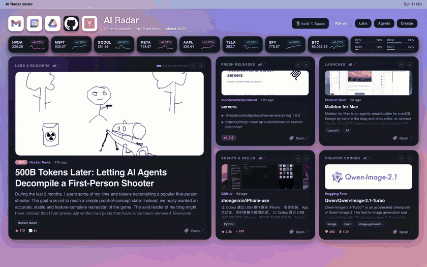
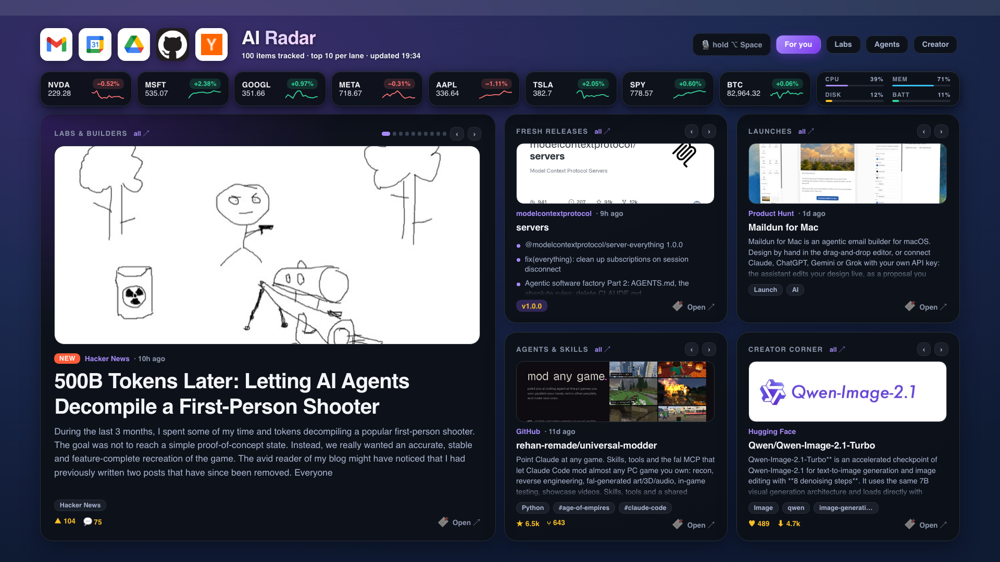
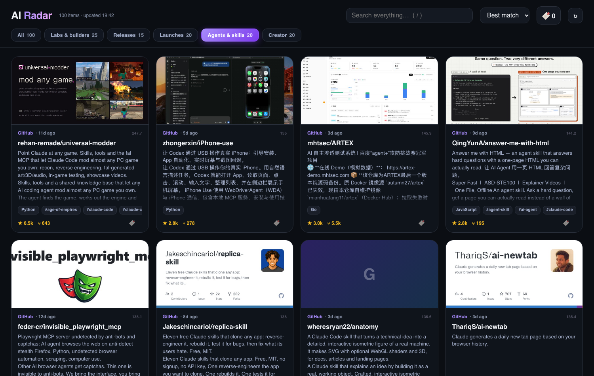

# AI Radar — a macOS desktop widget for AI news, agent repos & launches

**A glanceable, voice-controllable AI radar for your Mac desktop.** New agent repos, model releases, product launches and creator tools slide across your wallpaper — ranked by *your* interests, with images, summaries and one-click access to your daily apps. Local-first, no accounts, no API keys required.


<sub>30-second demo, rendered from the real widgets with live data — see [`demo/`](demo/) to rebuild it.</sub>


<sub>Screenshot uses live data and the example app shortcuts.</sub>

## Why this exists
Most "AI news" tools are digests you have to remember to open. AI Radar lives on your desktop (via [Übersicht](https://tracesof.net/uebersicht/)) so what's new is simply *there* when you glance over — and you can tell it what you care about out loud: *"boost reverse engineering"*, *"mute crypto"*, *"open Gmail"*.

|  |  |
|---|---|
| **Five lanes** | Labs & builders (OpenAI, Anthropic, DeepMind, Hugging Face, Simon Willison, Latent Space + top HN AI threads) · Fresh releases (with "what's new" bullets) · Product Hunt AI launches · New agent/skill/MCP repos on GitHub (with README summaries & banner images) · Creator corner (trending image/video/voice models) |
| **Carousel cards** | One item at a time with a real image, summary, tags and stats; ‹ › controls, pause on hover, respects *Reduce motion* |
| **Unlimited depth** | The desktop shows your top 10 per lane; **"all ↗"** opens a full page with search, sort, tabs and infinite scroll ([screenshot](docs/see-all.png)) |
| **Personal ranking** | Recency × popularity × your boost/mute keywords. Change them by editing `prefs.json` — or by voice/CLI |
| **Quick-access icons** | Your own app shortcuts (Gmail, Calendar, Notion, Lark… any URL), icon-only, opened in your Chrome profile |
| **Markets strip & system meters** | Your tickers with sparklines; CPU / memory / disk / battery |
| **Free voice control** *(optional)* | Hold **⌥ Space** and talk. Transcription runs **locally** (whisper.cpp); simple commands are matched by local rules; only open-ended requests use an LLM (see [Privacy](#privacy)) |
| **Responsive** | Everything scales with screen width and centers on big monitors; avoids the Dock |

### The full page
Click **all ↗** on any card to browse everything — search, sort, tabs, infinite scroll, equal-height cards.



## Install
Requirements: **macOS**, Python 3.9+, [Homebrew](https://brew.sh). Chrome is optional (used to open your app shortcuts).

```bash
git clone https://github.com/7hrn1/macos-ai-radar-widget.git
cd macos-ai-radar-widget
./install.sh            # add --voice for push-to-talk
```
The installer installs Übersicht (if needed), copies the widget, generates the config from the examples, downloads your app icons and does a first fetch (~15 s). Re-running it upgrades the widget and **keeps your `prefs.json` and `apps.json`**.

Then run `radar doctor` to check everything. Uninstall with `./uninstall.sh` (your config is backed up).

> **Optional but recommended:** run `gh auth login` (GitHub CLI) or export `GITHUB_TOKEN`. Without it GitHub allows only 60 requests/hour and the Agents lane gets thinner.

## Use it
**On the desktop** — hover a card to pause, click to open the item, click 🔖 to save it to `~/Documents/ai-radar-saved.md`, click **all ↗** for the full page.

**By text or voice** — `radar ask "…"` or hold ⌥ Space. A small panel above the Dock follows every step — *Listening → Transcribing → what it heard → Working → ✓ the reply* (plus what changed) — and the reply is spoken too. Click the panel to dismiss it. Set `voice_feedback` in `prefs.json` to change that.

| Say | Does |
|---|---|
| "refresh" | re-fetch everything now |
| "boost voice cloning" / "less of crypto" | add / remove an interest |
| "mute nft" / "unmute nft" | hide / unhide a topic |
| "minimum 500 stars" · "show 12 items" | filters / density |
| "show me the labs" · "open agents" · "find reverse engineering" | open the full page on a lane / search |
| "what's new in agents" · "brief me" | speak the top headlines |
| "open Gmail" · "go to calendar" | open an app shortcut |
| *anything else* ("I'm into video tools this week and hide Bitcoin") | optional LLM turns it into a validated preference change |

## Configure
Everything lives in `~/Library/Application Support/Übersicht/widgets/ai-radar/`.

**`prefs.json`**

| Key | Meaning |
|---|---|
| `boost` / `mute` | keywords that rank items higher / hide them |
| `min_stars`, `repo_days` | GitHub repo filters (stars, age in days) |
| `desk_items` | items per lane on the desktop (3–14); the full page always has all |
| `lanes` | turn lanes on/off: `{"creator": false}` |
| `releases_repos` | GitHub repos whose latest release you want to track |
| `tickers` | markets strip symbols |
| `lab_feeds` / `extra_feeds` | replace / add RSS feeds for the Labs lane: `[["Name", "https://…/feed.xml"]]` |
| `refresh_minutes` | how often the engine refetches (default 15) |
| `voice_feedback` | how replies reach you: `"both"` (on-screen text + spoken, default), `"text"` (on-screen only), `"speech"` (spoken only) |

**`apps.json`** — your shortcuts: `name`, `url`, `icon` (a domain; the icon is downloaded for you), optional `icon_url`, `plate: false` (for icons that are already rounded squares), `aliases` (what you can say), `color`. Set `chrome_profile` (e.g. `"Profile 1"`) to open links in a specific Chrome profile — find yours at `chrome://version`.

## How it works
```
 free public sources ──► engine.py ──► feed.json + img/ ──► Übersicht widgets (feed · quick · strip)
 (RSS, GitHub, HN,        score by prefs,                    radar.html (full page)
  Hugging Face, PH)       cache images locally               radar CLI  ◄── ⌥ Space ◄── Hammerspoon + whisper.cpp
```
~800 lines of Python, vanilla JS and JSX. No server of its own: Übersicht already serves the folder at `http://127.0.0.1:41416/ai-radar/`.

## Privacy
- **No accounts, no telemetry.** Everything runs on your Mac.
- **Network:** only to the public sources above (GitHub API, Hugging Face, Hacker News/Algolia, Product Hunt RSS, the lab blogs' RSS feeds and article pages, Yahoo Finance for tickers, Google's favicon/product-icon CDNs for your app icons) and to image hosts for thumbnails, which are downloaded once and cached under `img/`.
- **Voice:** audio is recorded only while you hold the hotkey, transcribed locally by whisper.cpp and then deleted on the next recording. The *text* of a request goes to an LLM **only** when no local rule matches **and** you have the `claude` CLI installed; the LLM can return nothing but a schema-validated preference patch (no tools, no file or shell access). Don't install it, and that path simply says it couldn't help.
- Links from feeds are untrusted: only plain `http(s)` URLs are ever opened, and all shell arguments are quoted.

## Known limitations
- macOS only (it's an Übersicht widget). The engine and `radar.html` are portable Python/HTML if you want to port the skin.
- Markets use Yahoo's **unofficial** chart endpoint — best effort, may break. Not financial advice.
- Anthropic news is read from a community-maintained mirror of their site (no official RSS); if it goes stale, swap it via `lab_feeds`.
- App shortcuts open in Google Chrome (falls back to your default browser).
- The first release has no settings UI — config is JSON/voice/CLI.
- English-only voice model by default.

## Roadmap
Settings & onboarding wizard · story de-duplication across sources · learning from your 🔖 saves · pluggable LLM backend (Ollama / any OpenAI-compatible) · source plug-ins · topic packs beyond AI · Homebrew tap.

## Contributing & credits
PRs welcome — see [CONTRIBUTING.md](CONTRIBUTING.md). Security issues: [SECURITY.md](SECURITY.md).
Ideas and sources borrowed from the excellent [Horizon](https://github.com/Thysrael/Horizon), [agents-radar](https://github.com/duanyytop/agents-radar) and [ai-news-radar](https://github.com/LearnPrompt/ai-news-radar) — if you want daily digests, email and web publishing, use those; AI Radar is for the desktop.
Built on [Übersicht](https://tracesof.net/uebersicht/), [whisper.cpp](https://github.com/ggerganov/whisper.cpp) and [Hammerspoon](https://www.hammerspoon.org/). All product names and logos belong to their owners.

MIT licensed.
